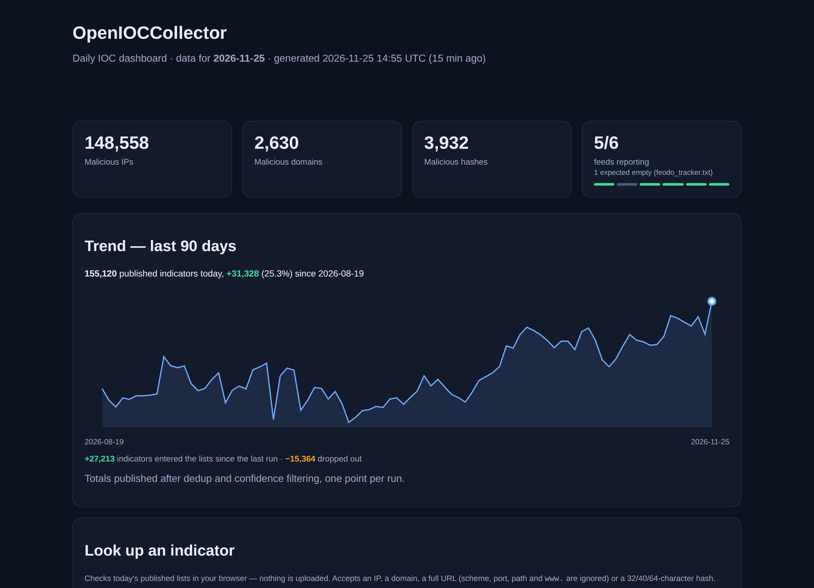
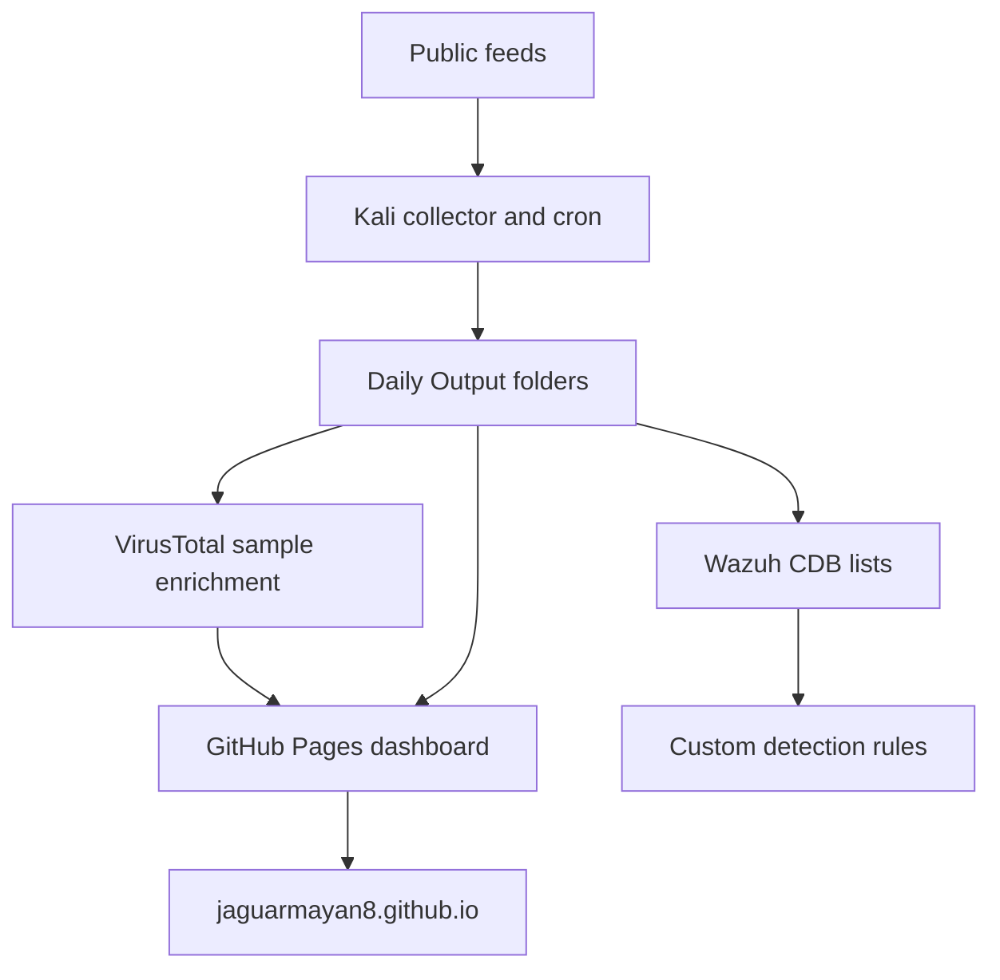

# OpenIOCCollector

**~155,000 deduplicated indicators of compromise, rebuilt from six public
threat-intelligence feeds every night, published as checksummed Wazuh CDB
lists with a staleness guard and a feed-health dashboard.**

[](https://github.com/jaguarmayan8/OpenIOCCollector/actions/workflows/collector.yml)
[](https://github.com/jaguarmayan8/OpenIOCCollector/actions/workflows/tests.yml)
[](LICENSE)
[](https://github.com/jaguarmayan8/OpenIOCCollector/commits/main)
[](https://www.python.org/)

[](https://jaguarmayan8.github.io/OpenIOCCollector/)

**Live dashboard → [jaguarmayan8.github.io/OpenIOCCollector](https://jaguarmayan8.github.io/OpenIOCCollector/)**

## What you get

- **One list to feed, not six to reconcile.** URLhaus, ThreatFox, SSLBL,
  Feodo Tracker, IPsum and MalwareBazaar are fetched, normalised (lowercase,
  no trailing dot, no `www.`, IDN folded), deduplicated across sources and
  filtered for confidence.
- **Three files Wazuh can load directly** — IPs, domains, hashes — each with
  provenance in the value (`1.2.3.4:threatfox:100`), plus `checksums.sha256`
  so the manager can prove it installed what GitHub published.
- **A guard that refuses to publish a broken day.** If any list shrinks below
  50% of the previous commit, or drops below 10 entries, the build aborts and
  the previous lists keep serving. A dead upstream must not silently blind
  your detection rules.
- **Answers, not just counts.** The dashboard shows feed health, VirusTotal
  corroboration for a sample of hashes, a 90-day trend with daily churn, and
  an in-browser lookup that needs no backend.

## Quick start

```bash
git clone https://github.com/jaguarmayan8/OpenIOCCollector.git
cd OpenIOCCollector
pip install -r requirements.txt          # requests only
export ABUSECH_AUTH_KEY=...              # free key: https://auth.abuse.ch/
export VT_API_KEY=...                    # optional, VirusTotal enrichment

python3 collector.py                     # fetch today's feeds
bash build_lists.sh                      # lists + guard + VT + dashboard + checksums
```

Then point Wazuh at the lists (below). `run_and_push.sh` runs both steps plus
the commit and is what cron calls; the GitHub Actions workflow runs the same
`build_lists.sh`, so CI and a home-lab cron cannot drift apart.

### Docker

The image runs the collector and nothing else — one pass, then exit. Lists,
dashboard and checksums run on the host, because the staleness guard reads the
previous list from git history and `.git` is deliberately not in the image.

```bash
docker run --rm -v "$PWD/Output:/app/Output" \
  -e ABUSECH_AUTH_KEY=... ghcr.io/jaguarmayan8/ioc-collector:latest
bash build_lists.sh                     # then the host pipeline, as above
```

Or from source: `docker compose build && docker compose run --rm ioc-collector`.
The compose service runs as `${LOCAL_UID:-1000}:${LOCAL_GID:-1000}` so it can
write into the bind-mounted `Output/`; if your account is not `1000:1000`,
export `LOCAL_UID=$(id -u)` and `LOCAL_GID=$(id -g)` first.

Keys come from the environment, or from `.env` (compose loads it
automatically). `.dockerignore` keeps `Output/`, `.git` and the key files out
of every image layer.

## Outputs

| File | Contents | Consumer |
| --- | --- | --- |
| `malicious-ips.txt` | IPs, one per line, provenance tail | Wazuh CDB list |
| `malicious-domains.txt` | domains from URLhaus + ThreatFox | Wazuh CDB list |
| `malicious-hashes.txt` | hashes from ThreatFox + MalwareBazaar | Wazuh CDB list |
| `threatfox-domains.txt` | ThreatFox-only domain sidecar | optional second list |
| `checksums.sha256` | SHA-256 of the three lists | the Wazuh puller |
| `docs/index.html` | the dashboard | GitHub Pages |
| `docs/api/manifest.json` | counts, feed health, per-file SHA-256, format | any consumer |
| `docs/history.json` | one point per run: counts, feed health, churn | the trend chart |

Every list entry is `<indicator>[:<feeds>[|<feeds>...][:<confidence>]]`:

```
1.2.3.4:threatfox:100
evil.example:threatfox:100|urlhaus
5.6.7.8:ipsum
```

Wazuh matches on the **key** only (`match_key` / `address_match_key`), so the
tail never changes which traffic a rule catches — it makes the list
self-describing and lets the dashboard answer "which feed, at what
confidence". Splitting a low-confidence tier into its own list is therefore a
filtering decision, not a matching change.

`docs/api/manifest.json` is the machine-readable view of a run — freshness,
counts, feed status, and the SHA-256 of each list — so a consumer can verify
what it downloaded without parsing Markdown or fetching 3 MB of text first.

## Wazuh integration

Selected IOCs are converted into Wazuh CDB lists and used by custom rules:

- Malicious IPs: rule `100100`
- Malicious domains: rules `100101` / `100102`
- Malicious hashes: rules `100110` / `100111`

### Pull, not push

The default is the **pull** model: `wazuh_pull_lists.sh` runs on the manager
(root cron), fetches the lists over HTTPS and verifies `checksums.sha256`.
Nothing on the collector side has to reach the manager, and a manager that is
offline simply catches up on its next run.

The legacy **push** model is opt-in — one variable in the cron entry:

```bash
WAZUH_PUSH=1 ./run_and_push.sh
```

It copies the lists over SSH via `wazuh_push.sh` with
`StrictHostKeyChecking=yes`, so the manager's host key must be in
`known_hosts` first; the script prints the exact `ssh-keyscan` command and the
fingerprint to compare. A push failure logs `WARNING` and the GitHub publish
still runs — it never aborts the job. Optional overrides: `WAZUH_HOST`,
`WAZUH_REMOTE_CMD`, `WAZUH_KNOWN_HOSTS`, `WAZUH_SSH_KEY`,
`WAZUH_CONNECT_TIMEOUT`.

## Feeds

| Feed | Type | Format | Notes |
| --- | --- | --- | --- |
| URLhaus | malware distribution URLs | CSV | abuse.ch, Auth-Key required |
| ThreatFox | malware IOCs, confidence-scored | JSON | abuse.ch, Auth-Key required |
| SSL Blacklist | malicious SSL certificates | CSV | abuse.ch SHA-1 fingerprints |
| Feodo Tracker | botnet C2 IPs | TXT | expected empty since Operation Endgame |
| IPsum | aggregated malicious IPs | TXT | stamparm/ipsum, level ≥ 3 |
| MalwareBazaar | confirmed malware samples | JSON | abuse.ch, `get_recent`, last 100 |

abuse.ch now requires a free Auth-Key for data exports (keyless URLs answer
`410 Gone`). The same key works for all of its platforms.

## How it runs



A daily job on Kali — or the GitHub Actions workflow, or the Docker image —
pulls the feeds, organises the output by year/month, publishes it, and
updates the CDB lists that the custom rules read.

The container image is published to GHCR on every push to `main` and on every
`v*` tag, so `docker run ghcr.io/jaguarmayan8/ioc-collector` works without a
clone.

## Project structure

```
OpenIOCCollector/
  Output/               daily dumps + summaries (raw dumps are unversioned)
  collector.py          fetches the six feeds
  ioc_extract.py        builds the CDB lists (URLhaus + ThreatFox + IPsum)
  infra_allow.txt       shared-infrastructure suppression tiers
  build_lists.sh        lists -> guard -> VT -> dashboard -> prune -> checksums
  run_and_push.sh       cron entry point (Kali host)
  gitpush.sh            cron entry point (Docker variant)
  generate_dashboard.py renders docs/index.html, docs/api/manifest.json, history
  lookup.js             the in-page lookup (no backend, IndexedDB-cached)
  vt_enrich.py          VirusTotal lookups for the sample hashes
  backfill_history.py   rebuilds docs/history.json from git history
  Dockerfile            collector-only image
  docker-compose.yml    one-shot collector job
  tests/                unittest suite, runs in CI before any push
```

## Development

```bash
python3 -m unittest discover -s tests -v     # 73 tests, no network, no keys
python3 generate_dashboard.py                # re-render from the newest Output/
python3 backfill_history.py --days 90        # rebuild the trend from git history
```

The tests cover the parts where a wrong answer looks like a working page: the
CDB line parser (IPv6 included), the URL/port/`www.` normalisation, the
infrastructure filter, the confidence filter, the staleness guard and the
dashboard's status classification. `tests/` imports no `requests`, so CI runs
it before anything can be published.

## Data storage model

Raw upstream dumps are **not** versioned. Committing them added ~38 MB/day
(URLhaus CSV ~30 MB + ThreatFox JSON ~7 MB) to git history permanently, which
pushed this repository past 1 GB — deleting the working-tree copy never
reclaimed the blobs.

| What | Where it lives | Retention |
| --- | --- | --- |
| Raw dumps (`urlhaus.csv`, `threatfox_recent.json`, …) | GitHub Release `iocs-YYYYMMDD` | 30 days (release), 3 days locally |
| CDB lists (`malicious-ips/domains/hashes.txt`) | repo root, checksummed | current version only |
| Run summaries / VT results | `Output/YYYY/YYYY-MM/YYYYMMDD/` | 90 days |

`publish_raw.sh` uploads the dumps and `prune_output.py` keeps the local disk
in check. See [SIZE_FIX.md](SIZE_FIX.md) for the one-time history rewrite.

## Scope

This is a home-lab project: it runs on one Kali box, publishes to one
repository and feeds one Wazuh manager. It is not a threat-intelligence
platform, has no SLA, and the data is only as good as the six upstream feeds —
always corroborate before you block on it.

## License

GPL-3.0-or-later. Copyright (C) 2026 Jorge Tejada. See [LICENSE](LICENSE).

---

Jorge Tejada — cybersecurity, detection engineering, home lab.
