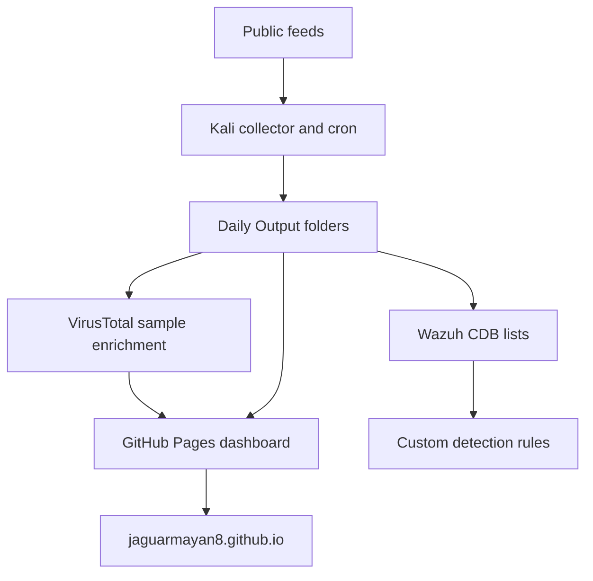

# OpenIOCCollector

Automated daily collection of Indicators of Compromise (IOCs) from public threat intelligence feeds.

This project collects, organizes, and stores IOCs from multiple open-source threat intelligence sources. It is designed for personal use in a detection engineering / SOC home lab environment and can be integrated with tools such as Wazuh.

## Features

- Collects IOCs from multiple public feeds
- Organizes output by year and month
- Runs automatically on a schedule
- Pushes results to GitHub
- Integrates selected IOCs into Wazuh CDB lists and custom rules

## Feeds Currently Collected

| Feed              | Type                       | Format  | Status | Notes                                   |
| ----------------- | -------------------------- | ------- | ------ | --------------------------------------- |
| URLhaus           | Malware Distribution URLs  | CSV     | Active | abuse.ch recently observed malware URLs |
| ThreatFox         | Malware IOCs               | JSON    | Active | abuse.ch high confidence malware IOCs   |
| SSL Blacklist     | Malicious SSL Certificates | CSV     | Active | abuse.ch SHA1 fingerprints of bad certs |
| Feodo Tracker     | Botnet C2 IPs              | TXT/CSV | Empty  | Currently no active C2s                 |
| Top Malicious IPs | Suspicious / Malicious IPs | CSV/TXT | Active | Aggregated malicious IP list            |
| MalwareBazaar     | Confirmed malware samples  | JSON    | Active | abuse.ch recent sample hashes (API `get_recent`, last 100) |

## Architecture



Daily collector on Kali pulls public threat intelligence feeds, organizes the output, pushes it to GitHub, and updates Wazuh CDB lists used by custom detection rules.

## Project Structure

OpenIOCCollector/
- Output/                 daily dumps + summaries (raw dumps are unversioned)
- collector.py            fetches the six feeds
- ioc_extract.py          builds the CDB lists (URLhaus + ThreatFox)
- infra_allow.txt         shared-infrastructure suppression tiers
- build_lists.sh          lists -> guard -> VT -> dashboard -> prune -> checksums
- run_and_push.sh         cron entry point (Kali host)
- gitpush.sh              cron entry point (Docker variant)
- generate_dashboard.py   renders docs/index.html
- vt_enrich.py            VirusTotal lookups for the sample hashes
- Dockerfile              collector-only image
- docker-compose.yml      one-shot collector job
- requirements.txt        requests
- tests/                  unittest suite (runs in CI before any push)
- README.md

## How to Run

```bash
git clone https://github.com/jaguarmayan8/OpenIOCCollector.git
cd OpenIOCCollector
pip install -r requirements.txt      # requests only; use a venv on Kali (PEP 668)
export ABUSECH_AUTH_KEY=...          # abuse.ch auth key
export VT_API_KEY=...                # optional - VirusTotal enrichment
python3 collector.py                 # collect today's feeds
bash build_lists.sh                  # lists, staleness guard, dashboard, checksums
```

`run_and_push.sh` runs both steps plus the commit; that is what cron calls.

### Docker

The image runs the collector and nothing else - one pass, then exit. Lists,
dashboard and checksums run on the host, because the staleness guard reads the
previous list from git history and `.git` is deliberately not in the image.

```bash
docker compose build
docker compose run --rm ioc-collector   # collects into ./Output
bash build_lists.sh                     # then the host pipeline, as above
```

Keys come from the environment, or from `.env` (compose loads it
automatically). `.dockerignore` keeps `Output/`, `.git` and the key files out
of every image layer. `gitpush.sh` chains the same three steps for a
Docker-based cron job.

## Wazuh Integration

Selected IOCs are converted into Wazuh CDB lists and used by custom rules:

- Malicious IPs: rule 100100
- Malicious domains: rules 100101 / 100102
- Malicious hashes: rules 100110 / 100111

The daily collector updates the IP, domain, and hash lists automatically.

## Future Improvements

- Convert collected IOCs into Wazuh CDB lists [Done]
- Add basic statistics [Done]
- Improve error handling for empty feeds [Done]
- Create a simple summary dashboard [Done]
- Add Docker support [Done] — collector image + one-shot compose job, see "How to Run → Docker"

## Dashboard

Live dashboard: https://jaguarmayan8.github.io/OpenIOCCollector/

The daily job generates `docs/index.html` from the latest IOC collection, feed status, CDB list counts, and VirusTotal sample.

## Author

Jorge Tejada
Cybersecurity | Detection Engineering | Home Lab

## License

GPL-3.0

## Data storage model

Raw upstream dumps are **not** versioned. Committing them added ~38 MB/day
(URLhaus CSV ~30 MB + ThreatFox JSON ~7 MB) to git history permanently, which
pushed this repository past 1 GB — deleting the working-tree copy never
reclaimed the blobs.

| What | Where it lives | Retention |
| --- | --- | --- |
| Raw dumps (`urlhaus.csv`, `threatfox_recent.json`, …) | GitHub Release `iocs-YYYYMMDD` | 30 days (release), 3 days locally |
| CDB lists (`malicious-ips/domains/hashes.txt`) | repo root, checksummed | current version only |
| Run summaries / VT results | `Output/YYYY/YYYY-MM/YYYYMMDD/` | 90 days |

`publish_raw.sh` uploads the dumps, `prune_output.py` keeps the local disk in
check. See [SIZE_FIX.md](SIZE_FIX.md) for the one-time history rewrite.
